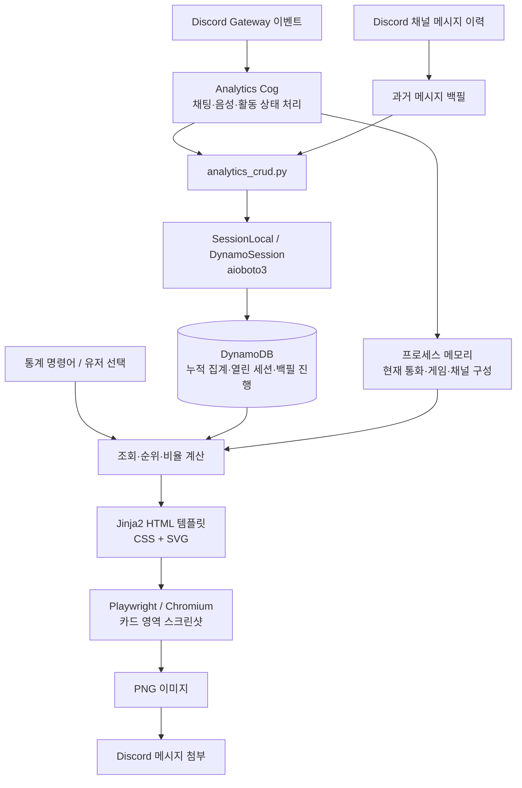

# Discord 활동을 통계 카드로 만들기: 이벤트 수집부터 DynamoDB, 이미지 렌더링까지

Discord 서버에서는 매일 메시지가 오가고, 음성 채널에 사람들이 모여 게임을 한다. 이 활동을 숫자로 정리하면 서버의 분위기를 다른 관점에서 볼 수 있다. 누가 대화를 많이 나누는지, 어느 시간대에 활동하는지, 누구와 자주 통화하고 어떤 게임을 함께 하는지 보여주는 것이다.

이 프로젝트의 통계 기능은 Discord 이벤트를 받아 활동량을 집계하고, 결과를 디자인된 이미지 카드로 제공한다. Python과 discord.py가 수집과 명령어를 담당하고, DynamoDB가 집계 데이터와 진행 중인 세션을 저장한다. 화면은 Jinja2로 HTML을 만들고 Playwright의 Chromium으로 PNG를 생성한다.

> 이 글은 2026년 11월 10일 저장소의 구현을 기준으로 작성했다. 별도 디자인 첨부가 없어 현재 통계 카드 템플릿을 기준으로 설명한다. 운영 환경의 실제 배포 상태나 성능 측정 결과를 의미하지는 않는다.

## 1. 카드에 어떤 정보를 담았는가

통계 화면은 채팅, 통화, 개인, 서버 전체의 네 가지 관점으로 구성된다.

| 화면 | 주요 내용 | 표현 방식 |
|---|---|---|
| 채팅 통계 | 누적 메시지 수, 기록 보유 사용자 수, 평균, 상위 15명 | 요약 숫자, 순위 막대, 시간대별 선 그래프 |
| 통화 통계 | 누적 통화 시간, 기록 보유 사용자 수, 평균, 상위 15명 | 요약 숫자, 순위 막대, 시간대별 선 그래프 |
| 유저 통계 | 개인 메시지 수·순위, 통화 시간·순위·횟수, 통화 상대, 게임 비중 | 개인 카드, 시간대 그래프, 비율 표시 |
| 서버 전체 통계 | 서버 인원, 채팅·통화 요약, 각 상위 5명, 최장 동시 통화 조합, 상위 게임 | 두 열 구성, 요약 카드, 작은 그래프, 게임 비중 |

여기서 ‘활성 사용자’는 최근 며칠 동안 활동한 사람을 뜻하지 않는다. 해당 누적 집계 목록에 포함된 사용자 수다. 평균도 전체 서버 인원이 아니라 해당 집계 목록의 사용자 수를 분모로 계산한다.

통화 시간은 사람별 접속 시간을 더한 값이다. 두 사람이 한 시간 통화하면 서버의 누적 통화 시간은 두 시간이 된다. 또한 게임 통계는 Discord 활동 상태에서 감지한 **음성 채널 접속 중의 게임 시간**이다. 게임의 승패나 전체 플레이 시간을 의미하지 않는다.

## 2. 전체 아키텍처



별도 통계 서버나 메시지 브로커를 두지 않고, 봇 프로세스 안에서 이벤트 처리와 조회, 렌더링을 수행한다. `api/`라는 디렉터리 이름이 있지만 이 통계 경로는 HTTP 요청을 거치지 않는다. Cog가 CRUD 함수를 직접 호출한다.

현재 구조는 원본 이벤트를 모두 저장한 뒤 조회 시마다 계산하는 방식보다 **이벤트 발생 시 집계값을 갱신하고, 조회 시 필요한 표현을 계산하는 방식**에 가깝다. 채팅 본문은 이 통계 테이블에 저장하지 않는다.

## 3. 코드의 책임 분리

```text
bot/
├── core/bot.py                   # Intents 설정, Analytics 확장 로드
└── cogs/analytics/
    ├── __init__.py               # 수집, 백필, 복구, 캐시, 명령어, 조회 조합
    ├── renderer.py               # HTML → PNG
    └── templates/
        ├── _analytics.html      # 공통 스타일과 차트 매크로
        ├── overview.html        # 채팅·통화 카드
        ├── user_stat.html       # 개인 카드
        └── server_overall.html  # 서버 전체 카드
api/
├── database.py                  # 비동기 DynamoDB 접근 래퍼
├── crud/analytics_crud.py        # 테이블 조회·증가·세션 처리
└── models/                      # ChatStat, VoiceStat 등 dataclass
scripts/init_dynamodb.py          # 키 스키마와 테이블 생성
```

표현 계층은 HTML 템플릿과 렌더러로 분리되어 있어 카드 디자인을 바꾸기 쉽다. 저장 연산도 CRUD 모듈에 모여 있다. 다만 이벤트 처리, 백필, 캐시, 순위 계산은 하나의 Cog에 함께 들어 있어, 기능이 커지면 수집 서비스와 조회 서비스를 분리할 여지가 있다.

모델은 Python `dataclass`다. 이 경로에서 SQLAlchemy ORM이나 SQL 세션을 사용하지 않는다. `SessionLocal`은 이름과 사용 문법이 세션처럼 보이지만 실제로는 aioboto3 리소스의 수명을 관리하는 컨텍스트 매니저다. 여러 쓰기를 자동으로 하나의 트랜잭션으로 묶어주지는 않는다.

## 4. DB 형태: DynamoDB 멀티 테이블

활동 통계는 키-값 및 문서 형태의 NoSQL 데이터베이스인 DynamoDB에 저장한다. 하나의 테이블에 모든 엔터티를 섞는 단일 테이블 설계가 아니라, 집계 목적별로 테이블을 나눈 구조다.

기본 테이블 접두사는 `discordbot`이며 `DYNAMODB_TABLE_PREFIX`로 변경할 수 있다. 아래 이름은 접두사를 생략한 논리 이름이다.

| 테이블 | 파티션 키 | 정렬 키 | 저장 내용 |
|---|---|---|---|
| `chat_stat` | `guild_id` | `user_id` 문자열 | 메시지 누적 수, 마지막 메시지 시각 |
| `chat_hourly` | `guild_id` | `user_id#HH` | 사용자별 KST 시간대 메시지 수 |
| `voice_session` | `guild_id` | `user_id#입장시각#임의값` | 진행 중인 통화의 입장 시각과 채널 |
| `voice_stat` | `guild_id` | `user_id` 문자열 | 누적 통화 초, 통화 횟수, 마지막 종료 시각 |
| `voice_hourly` | `guild_id` | `user_id#HH` | 사용자별 KST 시간대 통화 초 |
| `voice_pair` | `guild_id` | `작은 user_id#큰 user_id` | 두 사용자가 같은 채널에 머문 누적 시간 |
| `game_session` | `guild_id` | `user_id` 문자열 | 진행 중인 게임 이름과 시작 시각 |
| `game_stat` | `guild_id` | `user_id#game_name` | 사용자·게임별 누적 시간 |
| `backfill_progress` | `channel_id` | 없음 | 메시지 이력 탐색 커서와 완료 여부 |

대부분의 테이블에서 `guild_id`를 파티션 키로 사용한다. 동일한 사용자가 여러 서버에 참여해도 서버별 활동량이 섞이지 않도록 하기 위한 경계다. 개인 시간대 데이터는 정렬 키의 사용자 접두사로 조회한다.

예를 들어 다음 데이터는 특정 서버에서 사용자 123의 오후 9시 메시지 수를 뜻한다.

```json
{
  "guild_id": 100000000000000001,
  "sk": "123#21",
  "user_id": 123,
  "hour": 21,
  "message_count": 42
}
```

`HH`에는 날짜가 없다. 따라서 시간대 그래프는 일별 추이가 아니라 **수집된 전체 기간의 0~23시 활동 패턴**이다. 현재 스키마만으로 특정 주나 월의 통계를 다시 계산할 수는 없다.

CRUD 함수 일부는 `scan_*`이라는 이름을 쓰지만, 실제 구현은 `guild_id` 조건의 DynamoDB `Query`다. 서버 전체 조회는 `LastEvaluatedKey`를 따라 페이지를 모두 읽는다. 순위는 DB 인덱스로 가져오는 것이 아니라 읽어온 집계값을 Python에서 정렬한다.

테이블 생성 스크립트는 `PAY_PER_REQUEST`를 사용하며, 통계 테이블에 별도 보조 인덱스는 정의하지 않는다.

### 프로젝트에 PostgreSQL도 있는 이유

프로젝트 전체와 활동 통계의 저장소를 구분해야 한다. `api/dodo/store.py`와 `api/dodo/schema.sql`의 별도 게임 저장 계층은 asyncpg와 PostgreSQL을 사용한다. Docker Compose에는 PostgreSQL 17 Alpine이 정의되어 있다.

반면 이 글에서 다루는 채팅·통화·Discord 활동 기반 게임 시간은 `api/database.py`의 DynamoDB 경로를 사용한다. `DODO_DATABASE_URL`이 설정되어 있다고 해서 활동 통계가 PostgreSQL로 저장되는 것은 아니다.

## 5. 이벤트별 수집 흐름

### 채팅: 원자적 카운터 증가

`on_message`는 봇이 보낸 메시지와 DM을 제외하고 두 집계값을 갱신한다.

1. `chat_stat`의 사용자 누적 메시지 수를 증가시킨다.
2. 메시지 생성 시각을 KST 시간대로 변환해 `chat_hourly`를 증가시킨다.

카운터에는 DynamoDB `UpdateExpression`의 `ADD`를 사용한다. 애플리케이션에서 값을 읽고 1을 더해 다시 쓰는 과정 없이, 해당 항목의 증가 연산을 요청한다. 다만 두 테이블의 갱신 전체가 하나의 원자적 작업인 것은 아니다.

메시지 삭제·수정 이벤트를 반영해 카운터를 차감하는 로직은 없다. 따라서 평소의 카운터는 수신한 메시지 이벤트와 백필 결과의 누적값으로 이해해야 한다.

### 통화: 입장 때 세션 생성, 종료 때 누적

`on_voice_state_update`는 입장·퇴장·채널 이동을 처리한다. 음소거만 바뀌는 등 채널이 동일한 이벤트는 집계하지 않는다.

입장하면 `voice_session`에 시작 정보를 저장하고, 메모리의 `active_voice`에도 세션 키·입장 시각·서버 ID를 기록한다. 퇴장하면 경과 시간을 계산해 `voice_stat`과 `voice_hourly`에 반영하고 열린 세션 항목을 삭제한다. 종료된 통화 이력을 계속 쌓아두는 구조는 아니다.

채널 이동도 구간을 나누어 시간을 반영하지만, 이동 때문에 통화 횟수가 추가되지는 않도록 `bump_count=False`를 사용한다. 통화 횟수는 입장 즉시 증가하는 값이 아니라 최종 퇴장 처리에서 증가하는 값이다.

시간대별 통화 집계는 세션 시작 시각에 전부 몰아넣지 않는다. KST 21시 50분부터 23시 10분까지 통화했다면 21시에 10분, 22시에 60분, 23시에 10분을 배분한다.

완료 세션의 집계 시간은 최대 24시간으로 제한한다. UTC 시각으로 경과 시간을 계산하고, 시간대 버킷은 UTC에 9시간을 더해 KST로 변환한다.

### 함께 통화한 시간: 채널 구성 변경을 기준으로 계산

채널별 메모리 상태에는 참여자 집합과 해당 구성이 시작된 시각이 들어 있다. 입장이나 퇴장으로 구성이 바뀌기 직전, 기존 참여자들의 모든 두 명 조합에 경과 시간을 더한다.

세 명이 10분 함께 있었다면 A-B, A-C, B-C에 각각 10분을 반영한다. 사용자 ID는 작은 값부터 정렬해 같은 조합이 두 항목으로 나뉘지 않도록 한다.

이 데이터로 개인의 주요 통화 상대와 서버의 최장 동시 통화 조합을 표시한다. 실제 발화 여부나 친밀도를 측정하는 지표는 아니며, 같은 채널에 머문 시간이다. 세 명 이상이 함께 있으면 여러 상대의 시간이 동시에 쌓이므로 개인 통화 시간과 상대별 시간 합계도 다를 수 있다.

### 게임: 통화 중인 사용자의 활동 상태 추적

`on_presence_update`에서 `ActivityType.playing` 상태를 확인한다. 통화 중에 게임을 시작하면 `game_session`을 만들고, 게임 변경·종료 또는 음성 채널 퇴장 때 경과 시간을 `game_stat`에 반영한다. 여러 활동이 있을 때는 코드에서 처음 발견한 이름 있는 playing 활동을 사용한다.

이 경로는 Discord가 제공하는 활동 상태에 의존한다. 음성 채널 밖의 게임 시간이나 외부 게임 API의 실제 경기 결과를 수집하는 기능과는 범위가 다르다.

## 6. 과거 메시지 백필과 재시작 복구

봇 도입 이전의 채팅은 Discord 채널 이력을 읽어 채운다. 채팅·개인·서버 전체 통계 조회 경로에서 서버별 백필 작업을 확보하고 완료를 기다린다.

백필은 시작 시점의 Snowflake ID를 상한으로 잡고, 텍스트 채널별로 과거 방향으로 탐색한다. 읽은 메시지 200개마다 사용자별 수와 사용자·시간대별 수를 메모리에서 모아 집계 테이블에 반영한다. 이후 채널의 커서와 완료 상태를 `backfill_progress`에 저장한다. 이 200개는 DynamoDB 일괄 쓰기 API의 크기가 아니라 애플리케이션의 집계 반영 주기다.

권한이 없는 채널은 건너뛰고, 채널별 실패는 로그에 남긴다. 따라서 백필 완료 로그가 모든 채널의 완전한 수집을 보장하지는 않는다. 재분석 명령은 해당 서버의 채팅 집계와 진행 상태를 삭제한 뒤 다시 백필한다. 통화나 게임 시간을 재구성하는 명령은 아니다.

재시작 시에는 `_reconcile()`이 DB의 열린 세션과 현재 Discord 상태를 비교한다. 아직 통화 중인 사용자는 기존 시작 시각을 이어받고, 이미 나간 사용자의 열린 세션은 삭제한다. 게임도 같은 게임을 계속하고 있으면 이어받는다. 다만 봇이 꺼져 있는 동안 일어난 정확한 퇴장이나 게임 변경 시각까지 복원할 수는 없다. 통화 상대의 채널 구성은 재시작 시점부터 다시 추적한다.

## 7. 조회 성능과 현재 활동 반영

통화가 끝날 때만 DB를 갱신하면 현재 통화 중인 사용자는 시간이 멈춰 보인다. 이를 해결하기 위해 조회 결과는 다음 두 부분을 합친다.

```text
표시할 활동량 = DB에 반영된 누적값 + 진행 중인 세션의 경과 시간
```

통화 총량, 통화 상대, 게임 시간에 이 방식을 적용한다. 현재 통화의 시간대 분포도 조회 시 계산해 더한다. 화면을 생성할 때의 스냅샷이며, 전송한 PNG가 계속 갱신되는 것은 아니다.

DB 조회 결과는 서버·집계 종류별로 30초간 메모리에 보관한다. 사용자 표시 이름과 아바타의 API 조회 결과는 서버·사용자별로 10분간 캐시한다. Redis 같은 외부 캐시는 사용하지 않는다.

이 때문에 조회마다 같은 데이터를 읽는 양을 줄일 수 있지만, 저장된 집계값이 화면에 반영되기까지 지연이 생길 수 있다. 캐시는 이벤트마다 무효화되지 않으므로, 세션 종료 전후에는 저장 집계와 현재 세션 보정의 시점 차이도 발생할 수 있다. 엄밀한 실시간 일관성을 보장하는 구조는 아니다.

## 8. 디자인을 이미지로 구현하는 방법

이 프로젝트는 카드 그림을 픽셀 단위로 직접 그리는 대신 웹 레이아웃을 이미지로 변환한다.

1. Python이 순위, 시간 문자열, 비율과 표시 이름을 계산한다.
2. Jinja2가 이를 HTML 템플릿에 넣는다.
3. CSS로 카드, 두 열 레이아웃, 순위 막대와 색상을 구성한다.
4. SVG로 시간대 선 그래프 등을 표현한다.
5. Playwright가 Chromium에서 렌더링하고 `#card` 요소를 캡처한다.
6. PNG를 메모리의 `BytesIO`로 받아 Discord 메시지에 첨부한다.

공통 스타일과 그래프 매크로는 `_analytics.html`에 모았고, Riot 카드의 `_tokens.html`도 재사용한다. Jinja2 환경에는 HTML 자동 이스케이프가 설정되어 있다.

채팅·통화 카드는 폭 1400, 개인 카드는 1200, 서버 카드는 1600의 CSS 픽셀 기준으로 렌더링한다. `device_scale_factor=3`을 적용하며 카드 영역을 캡처하므로 출력은 고해상도 래스터 이미지가 된다.

차트에는 별도의 Chart.js나 Matplotlib을 사용하지 않는다. 시간대 그래프의 높이는 해당 그래프의 최대값을 100으로 정규화한다. 순위 막대도 1위 대비 비율이다. 따라서 그래프의 높이를 절대 건수로 읽거나, 서로 다른 카드의 선 높이만 비교해서는 안 된다. 게임 비중은 전체 집계 게임 시간 대비 비율이며, 상위 5개 밖의 항목은 ‘기타’로 합친다.

## 9. 사용 도구와 실행 환경

| 구분 | 도구 | 역할 |
|---|---|---|
| 언어·런타임 | Python, Docker 이미지 기준 3.13 | 봇과 통계 처리 |
| Discord 연동 | discord.py 2.7.1 | Gateway 이벤트, 명령어, 유저 선택 UI |
| 비동기 실행 | asyncio | 이벤트 처리, 백필 작업과 준비 상태 대기 |
| 통계 DB | DynamoDB | 집계값, 진행 중 세션, 백필 커서 |
| DB 클라이언트 | aioboto3 15.5.0 | 비동기 DynamoDB 접근 |
| 데이터 모델 | Python dataclasses | 조회 결과를 Python 객체로 표현 |
| 템플릿 | Jinja2 | 카드 HTML 생성 |
| 그래픽 표현 | HTML, CSS, SVG | 레이아웃과 차트 |
| 이미지 생성 | Playwright, Chromium | 브라우저 렌더링과 PNG 캡처 |
| 로컬 실행 | Docker Compose, DynamoDB Local | 개발용 구성 |
| 환경 설정 | python-dotenv, 환경 변수 | DB 접두사·리전·엔드포인트 설정 |

버전은 저장소의 `requirements.txt`와 Docker 설정 기준이다. Jinja2와 Playwright는 해당 파일에 버전이 고정되어 있지 않다.

로컬 Compose는 DynamoDB Local을 포트 8000으로 실행하고 봇에 `DYNAMODB_ENDPOINT_URL`을 전달한다. 엔드포인트가 없으면 코드가 AWS 리전 설정을 사용하며 기본 리전은 `ap-northeast-2`다. 운영 Compose에는 DynamoDB Local 서비스가 없으므로 실제 연결 대상은 배포 환경 설정을 확인해야 한다.

Docker 이미지 빌드 단계에서는 Python 의존성뿐 아니라 `playwright install --with-deps chromium`으로 브라우저와 시스템 의존성도 설치한다. 별도 웹 프런트엔드를 배포하지 않아도 Discord 안에서 디자인된 통계 카드를 제공할 수 있는 구성이다.

## 10. 현재 설계의 한계와 다음 개선 방향

현재 구현에는 집계 중심 설계의 장점과 그에 따른 제약이 함께 있다. 아래 항목은 이미 해결된 기능이 아니라 코드에서 확인되는 개선 여지다.

| 현재 특성 | 영향 | 개선 방향 |
|---|---|---|
| 날짜 없는 누적 집계 | 주간·월간 조회와 과거 재계산이 어려움 | 날짜 버킷 또는 보존 기간을 정한 이벤트 저장 |
| 여러 테이블에 순차 쓰기 | 일부 쓰기 실패 시 집계 간 차이 가능 | 트랜잭션·조건부 쓰기·멱등성 설계 |
| 백필 집계와 커서 저장이 분리됨 | 장애 후 같은 구간을 재반영할 가능성 | 배치 식별자와 원자적 진행 상태 갱신 |
| 실시간 수집과 백필이 동시에 동작 | 시작 경계에서 메시지가 중복 집계될 가능성 | 수집 경계 공유 또는 메시지 ID 중복 제거 |
| 단일 프로세스 메모리에 현재 상태 보관 | 다중 봇 인스턴스 간 상태 조정 필요 | 수집 담당 분리와 공유 상태 설계 |
| 서버 전체 집계를 읽은 뒤 정렬 | 서버 규모에 따라 조회량·정렬 비용 증가 | 별도 순위 집계 또는 조회 구조 재설계 |
| 같은 채널의 모든 사용자 쌍 계산 | 참여 인원이 많으면 조합 수가 제곱 수준으로 증가 | 집계 대상·주기와 채널 규모에 따른 처리 조정 |
| 요청마다 Chromium 실행 | 동시 요청에서 CPU·메모리 부담 가능 | 브라우저 재사용, 동시 실행 제한, 이미지 캐시 |

추가로 통화 총량은 24시간 제한을 적용하지만, 조회용 `_live_voice_hourly()`는 시작부터 현재까지의 시간을 그대로 분할한다. 장시간 세션에서는 총량과 시간대 그래프의 계산 범위가 달라질 수 있어 같은 정책으로 맞출 필요가 있다.

세션 종료도 읽기·삭제·누적 갱신을 순서대로 수행한다. 각 단계가 하나의 트랜잭션은 아니므로, 열린 세션 저장만으로 장애 시 무손실 처리나 중복 없는 처리가 보장되는 것은 아니다. 또한 DynamoDB 조회에 강한 일관성을 명시하지 않고 애플리케이션 캐시도 사용하므로, 원자적 카운터와 화면의 즉시 일관성은 구분해야 한다.

## 11. 구현에서 얻을 수 있는 설계 포인트

이 기능의 중심은 화면에 필요한 지표를 먼저 정하고, 그 지표를 만들기 쉬운 단위로 데이터를 축적하는 데 있다. 개인 누적값, 24개 시간대, 사용자 쌍, 게임 이름이라는 조회 단위를 키에 반영했고, 진행 중인 활동은 저장 집계와 분리해 관리했다.

표현에는 익숙한 웹 기술을 사용했다. 이를 통해 Discord 메시지라는 제한된 출력 환경에서도 요약 숫자, 순위, 선 그래프와 비율을 하나의 카드에 담을 수 있었다. 앞으로 데이터 신뢰성과 규모 확장이 중요해진다면, 수집의 중복 방지와 원자성, 날짜별 집계, 렌더링 자원 관리가 다음 설계 과제가 된다.

---

## 구현 근거 파일

아래는 글을 검토하거나 코드 링크를 추가할 때 참고할 저장소 내 경로다. 블로그 게시 시에는 공개 저장소의 해당 파일 링크로 바꾸면 된다.

- [`bot/cogs/analytics/__init__.py`](../bot/cogs/analytics/__init__.py): 이벤트 수집, 백필, 복구, 캐시, 명령어, 순위·비율 계산
- [`api/crud/analytics_crud.py`](../api/crud/analytics_crud.py): 실제 키 구성, Query, ADD, 세션 종료, 시간대 분할
- [`api/database.py`](../api/database.py): aioboto3 세션과 환경 설정
- [`scripts/init_dynamodb.py`](../scripts/init_dynamodb.py): 테이블 스키마, 접두사, 과금 모드
- [`api/models/`](../api/models/): 통계 dataclass
- [`bot/cogs/analytics/renderer.py`](../bot/cogs/analytics/renderer.py): Jinja2와 Playwright 렌더링
- [`bot/cogs/analytics/templates/`](../bot/cogs/analytics/templates/): 카드 디자인과 SVG 매크로
- [`bot/core/bot.py`](../bot/core/bot.py): Discord Intents와 확장 로드
- [`requirements.txt`](../requirements.txt), [`Dockerfile`](../Dockerfile): 라이브러리와 브라우저 설치
- [`docker-compose.yml`](../docker-compose.yml), [`docker-compose.prod.yml`](../docker-compose.prod.yml): 로컬·운영 실행 구성
- [`api/dodo/store.py`](../api/dodo/store.py), [`api/dodo/schema.sql`](../api/dodo/schema.sql): 별도 PostgreSQL 게임 저장 계층
